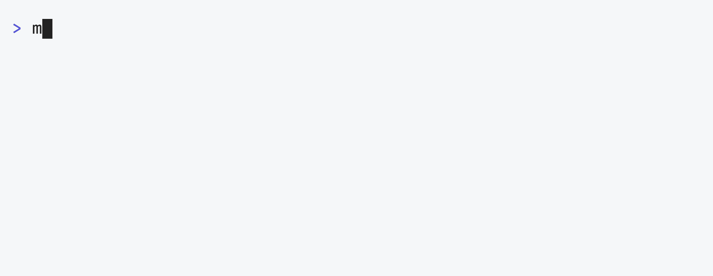
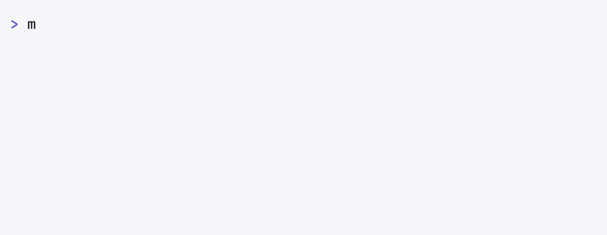

<h1 align="center">mli</h1>

<div align="center">

**📑 Manage macOS Login Items**

<br />

[](https://github.com/5ouma/mli/releases)

[](https://pkg.go.dev/github.com/5ouma/mli)
<br />
[](https://github.com/5ouma/mli/actions/workflows/ci.yml)
[](https://github.com/5ouma/mli/actions/workflows/release.yml)
[](https://github.com/5ouma/utils/actions/workflows/mli.yml)
[](https://codecov.io/gh/5ouma/mli)


</div>

<br /><br />

## 📥 Installation

- 🍺 Homebrew

  ```sh
  brew install 5ouma/tap/mli
  ```

<br />

- 🐹 Go

  ```sh
  go install github.com/5ouma/mli@latest
  ```

<br />

- 🐙 [GitHub Releases](https://github.com/5ouma/mli/releases)

  ```sh
  curl -L "https://github.com/5ouma/mli/releases/latest/download/mli_$(uname)_$(uname -m).tar.gz" | tar -x 'mli'
  ```

  ```sh
  gh release download -R='5ouma/mli' -p="mli_$(uname)_$(uname -m).tar.gz"
  tar -xf "mli_$(uname)_$(uname -m).tar.gz" 'mli'
  ```

<br /><br />

## 📊 Usage

```sh
📑 Manage macOS Login Items with JSON

Usage:
  mli [command]

Available Commands:
  check       Check Login Items
  help        Help about any command
  load        Load Login Items
  save        Save Login Items

Flags:
  -h, --help      help for mli
  -v, --version   version for mli

Use "mli [command] --help" for more information about a command.
```

<br /><br />

## 🕹️ Commands

### 📂 `Load`

```sh
📂 Load Login Items from JSON file

Usage:
  mli load [flags]

Flags:
      --file string   Load from this JSON file (default "./login_items.json")
  -h, --help          help for load
```

<div align="center">
  <picture>
    <source
      srcset="https://raw.githubusercontent.com/5ouma/mli/HEAD/docs/assets/vhs/light/load.gif"
      media="(prefers-color-scheme: light)"
    />
    <source
      srcset="https://raw.githubusercontent.com/5ouma/mli/HEAD/docs/assets/vhs/dark/load.gif"
      media="(prefers-color-scheme: dark)"
    />
    
  </picture>
</div>

<br />

### 💾 `Save`

```sh
💾 Save Login Items to JSON file

Usage:
  mli save [flags]

Flags:
      --file string   Save to this JSON file (default "./login_items.json")
  -f, --force         Overwrite existing file
  -h, --help          help for save
```

<div align="center">
  <picture>
    <source
      srcset="https://raw.githubusercontent.com/5ouma/mli/HEAD/docs/assets/vhs/light/save.gif"
      media="(prefers-color-scheme: light)"
    />
    <source
      srcset="https://raw.githubusercontent.com/5ouma/mli/HEAD/docs/assets/vhs/dark/save.gif"
      media="(prefers-color-scheme: dark)"
    />
    
  </picture>
</div>

### 🔍 `Check`

```sh
🔍 Check the Login Items are up-to-date

Usage:
  mli check [flags]

Flags:
      --file string   Check Login Items from this JSON file (default "./login_items.json")
  -h, --help          help for check
```

<div align="center">
  <picture>
    <source
      srcset="https://raw.githubusercontent.com/5ouma/mli/HEAD/docs/assets/vhs/light/check.gif"
      media="(prefers-color-scheme: light)"
    />
    <source
      srcset="https://raw.githubusercontent.com/5ouma/mli/HEAD/docs/assets/vhs/dark/check.gif"
      media="(prefers-color-scheme: dark)"
    />
    
  </picture>
</div>

<br /><br />

## 🆘 Help

- [**⚠️ Issues**]: Feature Requests or Bug Reports
- [**💬 Discussions**]: General Chats or Questions
- [**🛡️ Security Advisories**]: Security Issues that should not be public

[**⚠️ Issues**]: https://github.com/5ouma/mli/issues/new/choose
[**💬 Discussions**]: https://github.com/5ouma/mli/discussions/new/choose
[**🛡️ Security Advisories**]: https://github.com/5ouma/mli/security/advisories/new

<br /><br />

## 🎽 Contributing

I happily welcome your contributions!
Before you contribute,
I would recommend reading [CONTRIBUTING.md](../.github/CONTRIBUTING.md) for a better development experience.

<br /><br />

## 💡 Inspired by

- [🚀 **blacktop / lporg**](https://github.com/blacktop/lporg)
- [⌨️ **miclf / macos_keyboard_shortcuts_exporter_importer.php**](https://gist.github.com/miclf/bf4b0cb6de9ead726197db7ed3d937b5)
